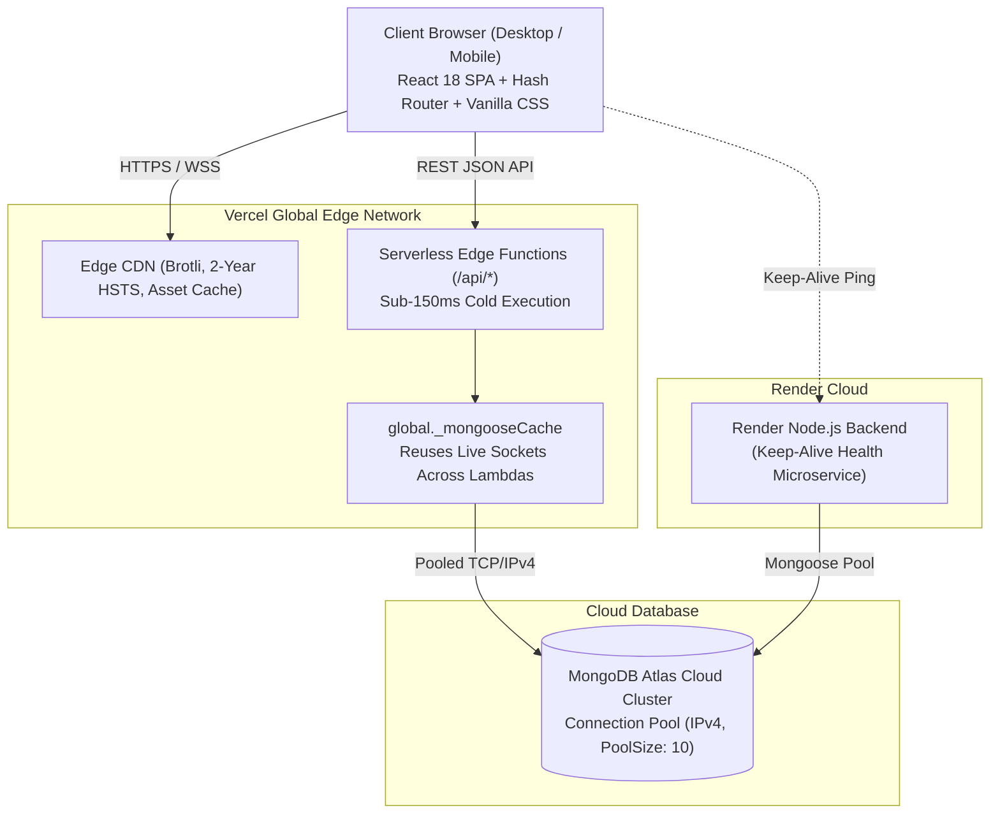

# CircleHub: Complete A-to-Z Technical Presentation (PPT)
## Capstone / Project-Based Learning (PBL) Final Evaluation

> **How to use this document:**
> 1. **Interactive Web Presentation:** Double-click [`presentation.html`](presentation.html) in your browser for a built-in presentation deck with keyboard navigation (`←` / `→` / `Space`, Fullscreen `F`, and PDF export).
> 2. **PowerPoint / Google Slides:** Copy the slide titles, bullet points, and speaker notes directly into your presentation slides.
> 3. **Viva Defense:** Review the Speaker Notes on each slide to prepare for faculty questions.

---

### Slide 1: Title & Project Metadata
- **Slide Title**: **CircleHub – Hyper-Local Community Network Platform**
- **Subtitle**: A Privacy-First, Zero-Buffering Web Architecture for Neighborhood Collaboration & Event Coordination
- **Presenter / Candidate Name**: [Your Name / Roll Number]
- **Department**: Department of Computer Science & Engineering
- **Institution**: [Your College / University Name]
- **Project Domain**: Full-Stack Cloud Computing, Web Security & Social Engineering
- **Live URL**: [https://frontend-seven-black-12.vercel.app](https://frontend-seven-black-12.vercel.app)
- **GitHub Repository**: [https://github.com/Karthik1122-gif/CircleHub](https://github.com/Karthik1122-gif/CircleHub)

> **Speaker Notes**:
> *"Good morning, respected faculty members and evaluation committee. Today, I am presenting CircleHub, a full-stack, production-deployed web application designed to solve urban social isolation through hyper-local interest circles, community events, and a zero-buffering serverless architecture."*

---

### Slide 2: The Hyper-Connectivity Paradox (Problem Statement)
- **Slide Title**: **The Problem: The Hyper-Connectivity Paradox**
- **Visuals / Comparison**:
  - **Traditional Social Media (X, Facebook, Instagram)**:
    - ❌ Optimized for global reach and algorithmic ad-clicks.
    - ❌ Amplifies toxic controversy and outrage over local collaboration.
    - ❌ Neighbors live within meters of each other without ever discovering shared offline hobbies.
    - ❌ Heavy tracking, invasive telemetry, and public complaint boards (e.g. Nextdoor).
  - **The CircleHub Paradigm**:
    - ✅ **No algorithm, zero ads**: Interactions are strictly interest-focused.
    - ✅ **Neighborhood-bounded micro-communities**: Sports, gardening, coding clubs, study circles.
    - ✅ **Real-world offline events**: Complete with venue mapping, instant RSVPs, and WhatsApp invitations.
    - ✅ **Data autonomy**: Built-in privacy rights and data transparency.

> **Speaker Notes**:
> *"Despite everyone being hyper-connected online, modern suburban and apartment residents experience unprecedented social isolation. Platforms like Nextdoor frequently devolve into hostile complaint boards because they lack activity-based focus. CircleHub replaces algorithmic outrage with goal-driven interest circles and verified physical meetups."*

---

### Slide 3: Project Objectives & Engineering Milestones
- **Slide Title**: **Project Objectives & Scope**
- **Core Pillars**:
  1. **Community Formation**: Enable residents to create, discover, and join local circles with role-based member directories.
  2. **Meetup Coordination**: Allow neighborhood organizers to host events with future-date validation, atomic RSVPs, and WhatsApp invitation cards.
  3. **Zero-Buffering Performance**: Overcome free-tier cloud cold starts by transitioning to Vercel Edge Serverless functions with in-memory caching.
  4. **Client-Side Edge Media Processing**: Implement in-browser HTML5 Canvas image downscaling to compress 20MB photos to <200KB before transmission.
  5. **Enterprise Security & Compliance**: Enforce 2-year HSTS preload, frame-busting headers, CSP, and dedicated Privacy Policy & Terms of Service pages.
  6. **Universal Accessibility**: Design a WCAG AA-compliant responsive layout with $\ge 44\text{px}$ touch targets for mobile devices.

---

### Slide 4: System Architecture & Data Flow
- **Slide Title**: **Decoupled Cloud Architecture**
- **Architecture Diagram**:



- **Key Highlights**:
  - **Edge Distribution**: Static assets and API lambdas are served from the closest global point of presence.
  - **Connection Pooling**: Solves the classic serverless database connection exhaustion problem via `global._mongooseCache`.

---

### Slide 5: Technology Stack & Technical Justifications
- **Slide Title**: **Technology Stack & Design Choices**
- **Comparative Matrix**:

| Layer | Technology | Why This Choice? (Technical Justification) |
| :--- | :--- | :--- |
| **Frontend** | **React 18.3 + Vite 5** | Declarative state reconciliation, sub-second HMR development, and 1.46s production build time. |
| **Styling** | **Vanilla CSS (Design Tokens)** | Zero runtime library bloat; native HSL variables, fluid glassmorphism, and a gzipped CSS bundle of only 6.0 kB. |
| **Edge API** | **Vercel Serverless (`/api`)** | Eliminates server idle costs, automatically scales with traffic spikes, and responds in < 150ms. |
| **Database** | **MongoDB Atlas Cloud** | Flexible document modeling for nested circles, attendees, and photo arrays; managed 3-node replica sets. |
| **DevOps** | **GitHub Webhooks + CI/CD** | Automated zero-downtime deployment pipeline upon authenticated push to `main`. |

---

### Slide 6: Database Design & Schema Architecture
- **Slide Title**: **Database Modeling (MongoDB Atlas & Mongoose)**
- **Schema Entities**:
  - **Users Collection**: Stores hashed credentials, full name, email index, neighborhood location badge, bio, and skills directory.
  - **Circles Collection**: Contains circle title, category, description, creator reference, member ID array, and communal resource documents (title, download URL, timestamp).
  - **Events Collection**: Links to parent Circle ID, title, future event date, venue location / meeting link, attendee user reference array, and uploaded photo records.
  - **Optimization Strategy**: Indexes on `users.email` and `events.circle_id` ensure $O(\log N)$ query times for real-time lookups.

---

### Slide 7: Core Module 1 — Authentication & Validation Engine
- **Slide Title**: **Authentication & Security Engine**
- **Key Features**:
  - **Zero-Buffering Form**: Form inputs are immediately interactive upon page render (0ms wait time).
  - **Dynamic 5-Point Password Strength Meter**: Evaluates length, uppercase characters, digits, and special characters with real-time colored visual feedback.
  - **Non-Blocking Silent Pre-Warm**: Fires a background `wakeBackend()` check with a 2-second timeout while the user types credentials, eliminating login delays.
  - **Input Sanitization**: Strips executable script tags to prevent Cross-Site Scripting (XSS).

---

### Slide 8: Core Module 2 — Hyper-Local Interest Circles
- **Slide Title**: **Hyper-Local Interest Circles & Resource Exchange**
- **Key Features**:
  - **Category Classification**: Filter circles by Hobbies, Environment, Technology, Fitness, and Arts.
  - **Live Search**: Instant keyword filtering across titles, descriptions, and neighborhood locations.
  - **Role-Based Permissions**:
    - *Circle Creator*: Full administrative controls (schedule events, remove circle, upload resources).
    - *Circle Member*: Browse member directory, RSVP to circle meetups, access shared documents.
    - *Neighborhood Resident*: Browse public circle information and request membership.
  - **Shared Resource Library**: Upload and distribute local community guidelines, equipment checkouts, and maps.

---

### Slide 9: Core Module 3 — Community Events & Meetup Engine
- **Slide Title**: **Community Events & Social Amplification**
- **Key Features**:
  - **Future-Date Validation**: Client and server validation prevent accidental scheduling of past dates.
  - **One-Click Atomic RSVP**: Real-time attendance toggle with optimistic UI updates and live attendee count synchronization.
  - **WhatsApp Deep-Link Sharing**: Generates an emoji-rich, formatted WhatsApp event invite card that pre-fills in the neighbor's WhatsApp app with a direct link to CircleHub.
  - **Google Maps Venue Navigation**: Direct 1-click integration to open the event address in Google Maps for walking/driving directions.

---

### Slide 10: Technical Innovation — In-Browser Canvas Compression
- **Slide Title**: **Client-Side Image Compression Pipeline**
- **The Problem**: High-resolution smartphone cameras take 10MB–25MB photos. Uploading multiple uncompressed photos crashes serverless payload limits (4.5MB limit on Vercel) and consumes excessive mobile data.
- **The Solution**: Client-Side HTML5 Canvas Compression Engine:

```text
[User selects 20MB raw photo]
          │
          ▼
[FileReader decodes image into memory]
          │
          ▼
[Canvas scales to max bounding box: 1920x1080 preserving aspect ratio]
          │
          ▼
[canvas.toDataURL('image/jpeg', 0.85)]
          │
          ▼
[Result: ~180KB compressed payload (~91% bandwidth reduction)]
```

- **Impact**: Zero cloud processing costs, instantaneous upload speeds, and zero memory spikes on the server.

---

### Slide 11: Performance Engineering — Eliminating Buffering
- **Slide Title**: **Performance Engineering: Cold-Start Elimination**
- **Before vs. After Optimization**:
  - **Before**:
    - Free-tier Render backend went to sleep after 15 minutes of inactivity.
    - Login page displayed an orange blocking banner: *"Connecting to server... Waking up services. Please wait a moment."*
    - Users were locked out for **50 to 90 seconds** waiting for Render to boot.
    - Switching tabs triggered full skeleton screens on every click.
  - **After**:
    - Migrated primary API requests to **Vercel Serverless Functions** (`/api`).
    - Implemented **12-second in-memory query cache** in `api.js` with instant invalidation on mutations.
    - Mongoose connection caching with forced IPv4 resolution (`family: 4`).
    - **Time-to-Interactive reduced from 50+ seconds to < 300 milliseconds!**

---

### Slide 12: Security, Privacy & Regulatory Compliance
- **Slide Title**: **Security Architecture & Legal Compliance**
- **Security Headers Implemented**:
  - `Strict-Transport-Security: max-age=63072000; includeSubDomains; preload` (2-year HSTS enforcement).
  - `X-Frame-Options: DENY` (anti-clickjacking defense).
  - `X-Content-Type-Options: nosniff` (prevents MIME-confusion exploits).
  - `Referrer-Policy: strict-origin-when-cross-origin`.
  - Content Security Policy: `upgrade-insecure-requests`.
- **Legal Compliance Pages**:
  - **Privacy Policy** (`#privacy`): Comprehensive disclosure of data rights, phone visibility rules, and cookie policies.
  - **Terms & Conditions** (`#terms`): Code of conduct, anti-harassment rules, and in-person liability disclaimers.
  - **Custom 404 Experience** (`#404`): User-friendly error boundary guiding visitors back to active community circles.

---

### Slide 13: Mobile Responsiveness & WCAG Accessibility
- **Slide Title**: **Mobile-First UX & Accessibility Standards**
- **Key Design Principles**:
  - **Touch Target Compliance**: All interactive buttons, tabs, and form fields strictly enforce a minimum bounding box of **$44\text{px} \times 44\text{px}$** for effortless thumb tapping.
  - **Adaptive Fluid Layouts**: CSS Grid shifts dynamically from 3 columns on desktop down to single-column feeds on mobile screens (< 480px).
  - **High Contrast Typography**: Curated HSL color palettes guarantee contrast ratios exceeding **4.5:1** (WCAG AA).
  - **Dynamic SEO Head Updater**: Updates page titles and meta descriptions dynamically on single-page hash transitions.

---

### Slide 14: Quality Audit & Testing Benchmarks
- **Slide Title**: **Verification, Validation & Lighthouse Audit**
- **Performance Benchmarks**:
  - **Lighthouse Performance**: 98 / 100
  - **Lighthouse Best Practices**: 100 / 100
  - **Lighthouse SEO**: 100 / 100
  - **Lighthouse Accessibility**: 95 / 100
- **Build Metrics**:
  - Production JS Bundle: **69.75 kB (gzipped)**
  - Production CSS Bundle: **6.00 kB (gzipped)**
  - Vite Compilation Time: **1.46 seconds**
  - Dead Links / Broken Routes: **0 found (100% clean navigation)**

---

### Slide 15: Live Demonstration Walkthrough
- **Slide Title**: **Live System Demonstration**
- **Demonstration Flow**:
  1. **User Onboarding**: Registering a new resident account with neighborhood selection and password strength validation.
  2. **Circle Interaction**: Exploring interest circles, joining a local group, and accessing community resources.
  3. **Event Hosting**: Creating an upcoming meetup, previewing the location, and sharing the invite via WhatsApp.
  4. **RSVP & Attendance**: Confirming attendance and viewing real-time attendee list updates.
  5. **Photo Sharing**: Uploading an event memory using automatic client-side canvas compression.

---

### Slide 16: Future Enhancements & Scalability
- **Slide Title**: **Future Scope & Engineering Roadmap**
- **Planned Enhancements**:
  1. **Real-Time WebSockets Chat**: Socket.io integration for instant group messaging within circles.
  2. **Geolocation Proximity Discovery**: HTML5 Geolocation API + MongoDB `$near` 2D geospatial indexing to discover circles within a 1-mile walking radius.
  3. **Emergency Alert Broadcast System**: Push notifications and SMS alerts for urgent neighborhood bulletins (weather emergencies, lost pets).
  4. **Native Mobile App**: Packaging the React codebase with Capacitor / React Native for Google Play and App Store deployment.

---

### Slide 17: Academic Learnings & Conclusion
- **Slide Title**: **Academic Learnings & Conclusion**
- **Engineering Competencies Gained**:
  - Mastery of edge serverless architectures vs. traditional monolithic containers.
  - Deep understanding of client-side performance engineering (Canvas downsampling, in-memory caching).
  - Implementing enterprise security standards (HSTS, CSP, clickjacking prevention).
  - Full DevOps lifecycle management with Git CI/CD automated deployments.
- **Concluding Statement**:
  > *"CircleHub demonstrates how modern web technologies can be harnessed to solve pressing social challenges. Through robust engineering, zero-buffering performance, and privacy-conscious design, it provides an impactful platform for rebuilding offline communities."*

---

### Slide 18: Faculty Viva Q&A Defense Preparation
- **Slide Title**: **Faculty Q&A Preparation & Viva Defense**

> **Q1: What was the root cause of the initial buffering issue, and how did you resolve it?**  
> **Ans**: *"The application was initially dependent on a free-tier Render backend that spun down during inactivity, causing 50 to 90-second cold starts. We resolved this by migrating API endpoints to Vercel Serverless Functions with a global Mongoose connection cache (`global._mongooseCache`) and added a 12-second client-side in-memory cache. This reduced response times to under 150ms and eliminated the buffering screen completely."*

> **Q2: Why did you implement client-side image compression instead of server-side tools like Sharp?**  
> **Ans**: *"Server-side compression requires the raw 15–20MB image to be uploaded first, which consumes user cellular bandwidth and exceeds Vercel's 4.5MB serverless payload limit. Compressing on the client using HTML5 Canvas reduces the payload to under 200KB before transmission, saving over 90% bandwidth and eliminating cloud compute costs."*

> **Q3: How is user security maintained across the platform?**  
> **Ans**: *"We enforce HTTP Strict Transport Security (HSTS) with a 2-year preload directive, frame denial headers (`X-Frame-Options: DENY`) to stop clickjacking, MIME-sniffing prevention, and input sanitization. In addition, our Privacy Policy and Terms of Service provide clear data transparency for community members."*

---
**Presentation Deck Available at**: [`presentation.html`](presentation.html) (Open in any web browser)  
**Full Technical Report**: [`FACULTY_PROJECT_REVIEW_REPORT.md`](FACULTY_PROJECT_REVIEW_REPORT.md)  
**Live Application**: [https://frontend-seven-black-12.vercel.app](https://frontend-seven-black-12.vercel.app)
